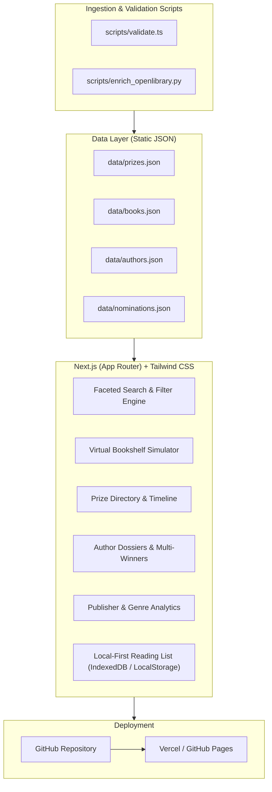

# Fiction Prize Index: Project Specification & Architecture

An open-access, static-first catalog and discovery platform for major literary fiction prizes, awards, winners, finalists, and publishing metadata. Inspired by Benjamin Breen's [Book Prize Index](https://book-prize-index.vercel.app).

---

## 1. Vision & Purpose

Discovering prize-winning and shortlisted literary fiction is currently hindered by fragmented sources: official prize foundations operate distinct, often poorly archived websites, publishers issue transient press releases, and commercial algorithms prioritize sponsored bestsellers over award-validated literature.

The **Fiction Prize Index** serves as an open, structured, and verifiable index of world-class fiction honors. It centralizes:
- Major English-language literary prizes
- Translated and international fiction awards
- Speculative, crime, and genre-defining fiction prizes
- Innovative and mould-breaking fiction awards
- Historical nominee data with source links and bibliographic metadata

The platform is designed to be:
1. **Fast & Static-First**: Zero database dependencies, fully client-browsable, deployable to Vercel or GitHub Pages.
2. **Transparent & Source-Linked**: Every award entry links to an official citation, archive, or press announcement.
3. **Curator & Reader-Centric**: Features a multi-faceted search engine, a virtual bookshelf browser, author dossiers, prize analytics, and a local-first personal reading list.
4. **Community & Contributor-Friendly**: Built on transparent JSON datasets with validation and enrichment scripts so the literary community can submit corrections and add prize cycles via GitHub pull requests.

---

## 2. Prizes in Scope

### Tier 1: Major English-Language Literary Honors
- **The Booker Prize** (1969–present) — UK / Commonwealth / Global English fiction
- **The Pulitzer Prize for Fiction** (1918–present) — Distinguished fiction by American authors
- **National Book Award for Fiction** (1950–present) — Outstanding American literary achievement
- **Women's Prize for Fiction** (1996–present) — Outstanding full-length novel by a woman
- **National Book Critics Circle (NBCC) Award for Fiction** (1975–present) — Honored by professional critics
- **PEN/Faulkner Award for Fiction** (1981–present) — American fiction chosen by peer writers

### Tier 2: International & Translated Fiction
- **Nobel Prize in Literature** (1901–present) — World literature masters, prose and fiction laureates
- **International Booker Prize** (2005–present) — Fiction translated into English, honoring author and translator equally
- **International Dublin Literary Award** (1996–present) — World literature nominated by public libraries worldwide
- **Prix Goncourt** (Selected translated / international crossover focus)

### Tier 3: Form, Innovation & Debut Fiction
- **The Goldsmiths Prize** (2013–present) — Rewarding fiction that breaks the mould or extends the possibilities of the novel form
- **PEN/Hemingway Award** (1976–present) — Distinguished first novel or collection by an American author

### Tier 4: Speculative & Genre Distinction
- **Hugo Award for Best Novel** (1953–present) — Science fiction and fantasy literature
- **Nebula Award for Best Novel** (1966–present) — Peer-awarded speculative fiction (SFWA)
- **Edgar Allan Poe Award for Best Novel** (1954–present) — Mystery, crime, and thriller fiction (MWA)
- **World Fantasy Award for Best Novel** (1975–present) — Outstanding fantasy literature

### Tier 5: Commonwealth & Regional
- **Scotiabank Giller Prize** (1994–present) — Excellence in Canadian fiction
- **Miles Franklin Literary Award** (1957–present) — Australian literature of highest literary merit
- **Kirkus Prize for Fiction** (2014–present) — Selected from starred Kirkus reviews

---

## 3. System Architecture & Tech Stack



### Technical Stack
- **Framework**: Next.js 14/15 with React 18/19 and App Router
- **Language**: TypeScript (strict mode enabled)
- **Styling**: Tailwind CSS with custom literary theme (warm paper tones, serif typography, dark mode)
- **Icons**: Lucide React
- **Storage (Client-Side)**: LocalStorage / IndexedDB for user's personal shelf & reading progress
- **Export Formats**: CSV, Markdown reading list, JSON export
- **Hosting & CI/CD**: GitHub Repository with GitHub Actions for schema validation & automated build; deployable to Vercel or GitHub Pages (static export)

---

## 4. Data Schemas

### `Prize`
```typescript
interface Prize {
  id: string;              // e.g. "booker-prize"
  name: string;            // "The Booker Prize"
  shortName: string;       // "Booker"
  establishedYear: number; // 1969
  country: string;         // "United Kingdom"
  sponsor: string;         // "Booker Prize Foundation"
  websiteUrl: string;      // "https://thebookerprizes.com"
  description: string;
  category: "literary" | "international" | "speculative" | "crime" | "innovation" | "debut";
  purse?: string;          // e.g. "£50,000"
}
```

### `Book`
```typescript
interface Book {
  id: string;              // e.g. "lincoln-in-the-bardo"
  title: string;
  authorId: string;
  authorName: string;
  publicationYear: number;
  publisher: string;
  imprint?: string;
  isbn13?: string;
  genres: string[];        // ["Historical Fiction", "Experimental", "Literary"]
  synopsis: string;
  coverImage?: string;     // URL or local asset path
  openLibraryKey?: string;
  pageCount?: number;
}
```

### `Nomination`
```typescript
interface Nomination {
  id: string;              // unique ID
  prizeId: string;
  bookId: string;
  year: number;
  status: "winner" | "shortlist" | "longlist" | "finalist";
  citation?: string;       // Official jury praise or citation
  sourceUrl: string;       // Direct link to official prize archive/announcement
  translator?: string;     // First-class translator credit for translated works
}
```

### `Author`
```typescript
interface Author {
  id: string;
  name: string;
  nationality?: string;
  birthYear?: number;
  bio?: string;
  websiteUrl?: string;
}
```

---

## 5. Core Application Features

1. **Master Fiction Index**:
   - Live omni-search matching title, author, synopsis, genre, and publisher.
   - Granular multi-select filters: Prize, Year Range, Award Status, Genre, Country, Publisher.
   - Dual viewing modes: Data Table / Catalog Grid.

2. **Virtual Bookshelf Simulator**:
   - Visual shelf browser displaying book spines with authentic typography and binding colors.
   - Hover and click interactions to pull books from the shelf and inspect nominations and synopses.
   - Sort shelf by year, page count (thickness), prize, or author.

3. **Prize Timeline & Dossier**:
   - Dedicated landing page for each major prize.
   - Year-by-year chronological timeline of winners and shortlisted companions.
   - Historical context and jury criteria.

4. **Author Hall of Fame & Overlap Index**:
   - Highlight of authors with multiple wins (e.g., Hilary Mantel, Colson Whitehead, J.M. Coetzee, Jesmyn Ward).
   - "Fiction Triple Crown" / Overlap analyzer (books nominated for both Booker & Women's Prize, or Pulitzer & National Book Award).

5. **Publisher & Literary Ecosystem Insights**:
   - Market share of winning imprints (indie vs. big five conglomerates).
   - Genre distribution across decades.

6. **Personal Reading Shelf**:
   - Save books to "Want to Read", "Currently Reading", or "Completed".
   - Export curated reading lists to Markdown or CSV.
   - Persistent across browser sessions without requiring an account.

7. **Translator Visibility & First-Class Credits**:
   - Integrated translator attribution across search, modal, shelf, and exports.

8. **Mobile & Responsive Experience**:
   - Touch-friendly adaptive bottom-sheet drawer on mobile.
   - Browser back-button integration (`popstate`) and URL deep-linking (`?book=<bookId>`).

---

## 6. Project Roadmap

- [x] Architectural Specification & Data Schema design (`PROJECT_SPEC.md`)
- [x] Next.js project with TypeScript, Tailwind CSS, App Router, and Lucide icons
- [x] Git repository with `.gitignore` and GitHub Pages deployment workflow
- [x] Master static JSON datasets (`data/prizes.json`, `data/books.json`, `data/authors.json`, `data/nominations.json`)
- [x] Faceted omni-search & multi-filter engine (Grid and Table views)
- [x] Virtual Bookshelf Simulator with dynamic spine page widths and foil seals
- [x] Prize Directory & timeline views
- [x] Author Dossiers & Multi-Winner Overlap Club
- [x] Publishing Ecosystem & Genre distribution analytics
- [x] Local-first personal reading list with Markdown & CSV exports
- [x] Data validation script (`scripts/validate.ts`) with zero-tolerance relational integrity
- [x] GitHub Actions CI & automatic GitHub Pages deployment pipeline
- [x] First-class translator credits for translated world literature
- [x] Cover art integration with Open Library fallback
- [x] Adaptive mobile/iPhone bottom drawer modal with deep links & popstate support
- [x] 100% full historical coverage for The Booker Prize (1969–2026)
- [x] 100% full historical coverage for The Pulitzer Prize for Fiction (1918–2026 winners + 1980–2026 finalists)
- [x] 100% full historical coverage for National Book Award for Fiction (1950–2026)
- [x] 100% full historical coverage for Hugo Award for Best Novel (1953–2026)
- [x] 100% full historical coverage for Nebula Award for Best Novel (1965–2026)
- [x] 100% full historical coverage for National Book Critics Circle Fiction (1975–2025)
- [x] 100% full historical coverage for Women's Prize for Fiction (1996–2026 winners + shortlists)
- [x] 100% full historical coverage for International Dublin Literary Award (1996–2026)
- [x] 100% full historical coverage for International Booker Prize (2005–2026)
- [x] 100% full historical coverage for The Goldsmiths Prize (2013–2026)
- [x] Comprehensive fiction & prose roster for Nobel Prize in Literature (1905–2025)
